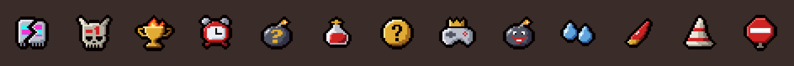

# Risacca Mod

Mod per **The Binding of Isaac: Repentance** dedicata a [Risacca](https://www.youtube.com/@Risaacca), che ogni giorno carica una run di Repentance.



## Cosa fa

### Scritte a schermo

| Quando | Scritta |
|---|---|
| Inizio di una nuova run | *Ciao a tutti, io sono Risacca*, poi *Benvenuti sul mio canale* |
| Ogni nuovo piano | *È XL?*, poi *SÌ, È XL!* oppure *No... non è XL* |
| Oggetto di qualità 3 / 4 | *IL GODOR!* / *GODOR MAXIMOR!* |
| Oggetto preso con un patto col diavolo | *Alla facciazza vostra!* |
| Colpo da un cuore intero | *Tacchino!* |
| Resti a mezzo cuore | *C'ho l'ansia* |
| Compare The Beast / Mega Satan | *IL BEASTY BOY* / *MEGA STANLEY KUBRICK* |
| Boss finale sconfitto | *Un bacione grande*, poi *dal vostro Risacca* |
| Morte | *Beduins* |
| Boss ancora vivo dopo 60 secondi nella stanza | *Non muore!* |
| Uso del D6 | *Fammi sognare* |

### Oggetti nuovi

- **Ho Rotto il Gioco** (attivo, 6 cariche): fa comparire un oggetto glitchato, come con TMTRAINER.
- **-1 al Dead God** (passivo): ogni boss sconfitto dà +0.2 danno, +0.03 velocità, +0.1 gittata e un tiro un po' più rapido. Il bonus arriva al massimo a 10 boss e conta un solo boss per stanza.
- **Win Streak** (trinket): dà +0.5 danno per ogni piano finito senza essere colpiti. Basta un colpo per azzerare la serie.
- **Non Vi Rubo Altro Tempo** (attivo, 4 cariche): congela i nemici della stanza per 3 secondi. Scritte: *Non vi rubo altro tempo*, poi *3, 2, 1... Ah no, aspetta*.
- **La Mossa del Pro Player** (attivo, 3 cariche): +2 danno fino al cambio di stanza, con la scritta *La mossa del pro player!*. Se ti colpiscono perdi il bonus e compare *Sono un cretino*.
- **Potrebbe Stare Qua** (passivo): a ogni nuovo piano mostra le stanze segrete sulla mappa e dà 2 bombe. Scritta alla prima visita di una stanza segreta: *Potrebbe stare qua!*.
- **Il Miracolo di San Gennaruzzo** (passivo, nelle stanze dell'angelo): +25% di probabilità di una stanza dell'angelo a ogni nuovo piano e un cuore eterno alla prima visita di ognuna, con la scritta *Il miracolo di San Gennaruzzo!*.
- **Che Fai, Te Ne Privi?** (trinket): 25% di probabilità di un pickup in più quando finisci una stanza, con la scritta *Che fai? Te ne privi?*.

Con [External Item Descriptions](https://steamcommunity.com/sharedfiles/filedetails/?id=836319872) attiva, gli oggetti mostrano anche la loro descrizione in italiano. Il riquadro Item Info del menu di pausa li mostra comunque come "Unknown": è un limite dell'API del gioco.

### Nomi alla Risacca

Gli oggetti originali del gioco vengono rinominati nei nomi e nelle descrizioni:

| Originale | Diventa |
|---|---|
| key / keys | Chiaviz-Chiavoz |
| bomb / bombs | Bombiz-Bomboz |
| boss / bosses | Beppe Bossicchio |
| Mega Satan | Mega Stanley Kubrick |
| Treasure Room | Stanza d'Auro |
| Bumbo | Bumbazzo |
| Greed | Ballerino di Flamenco |
| Incubus | Il buddy più forte del gioco |

## Installazione

La mod non è ancora sullo Steam Workshop.

1. Scarica `risacca-mod.zip` dalle [release](https://github.com/xdelmo/risacca-mod/releases) ed estrailo dentro `...\steamapps\common\The Binding of Isaac Rebirth\mods\`.
2. Attivala dal menu **Mods** del gioco.

Serve Repentance, ed è provata su Repentance+ v1.9.7.17. La mod non ha bisogno di REPENTOGON né di altre mod.

Le prove in gioco ancora da fare sono in [docs/da-fare-su-windows.md](docs/da-fare-su-windows.md).

## Sviluppo

Servono Lua (il codice è compatibile con 5.3) e Python 3 con Pillow. Lancia i comandi dalla root della repo:

```bash
lua tests/test_logic.lua   # test della logica
lua tests/smoke.lua        # test di main.lua con un'API Isaac finta
python3 tools/build.py     # crea dist/risacca-mod.zip
```

Per rigenerare le rinomine:
1. Estrai `items.xml`, `pocketitems.xml` e `stringtable.sta` con il ResourceExtractor del gioco.
2. Mettili in `extracted/`.
3. Lancia `python3 tools/rename.py extracted`.

Le immagini degli oggetti devono essere in pieno stile The Binding of Isaac: Repentance+. Si generano da griglie di caratteri con `python3 tools/sprites.py`, e per disegnarle si usano le skill in `.agents/skills/`.

I dettagli sull'architettura sono in [CLAUDE.md](CLAUDE.md).

---

*Un bacione grande dal vostro Risacca.*
